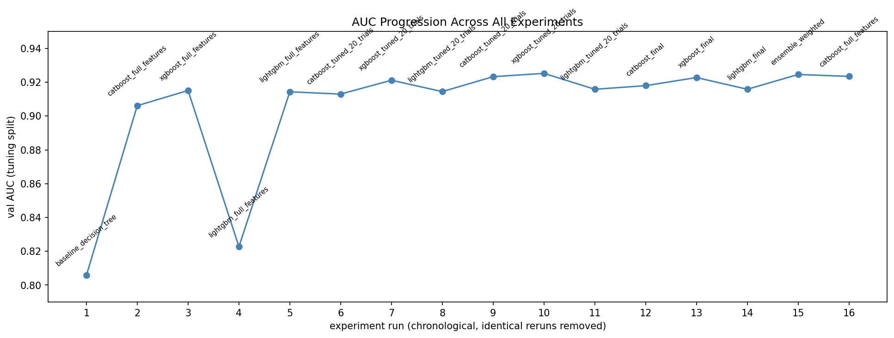
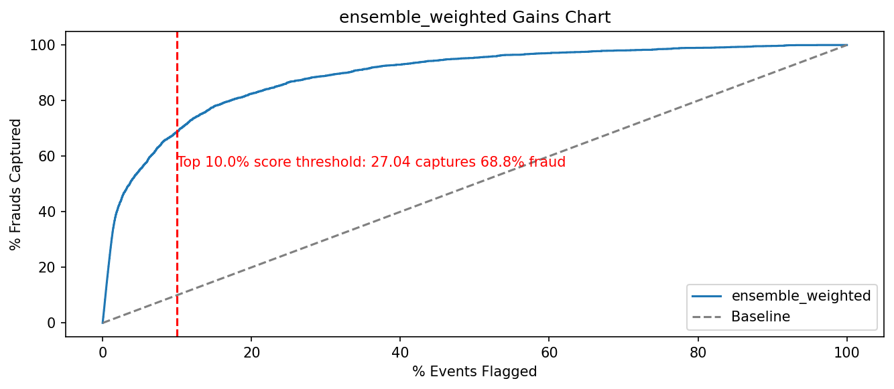
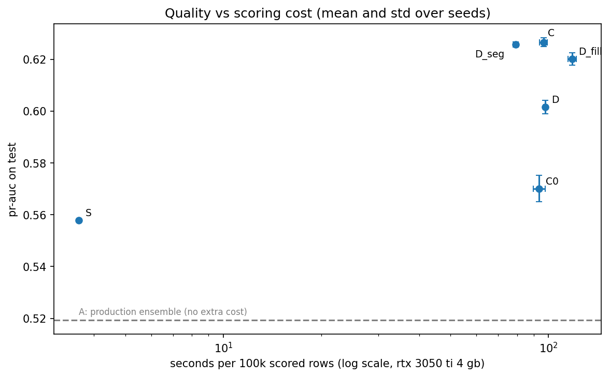
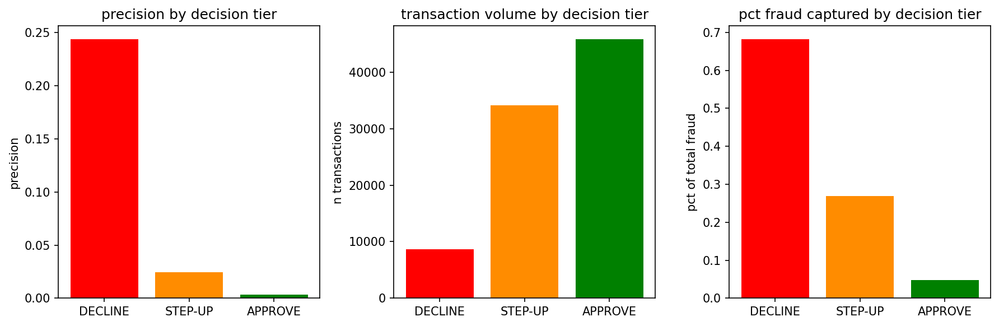
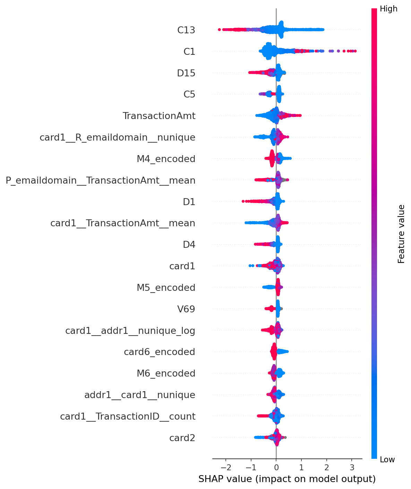
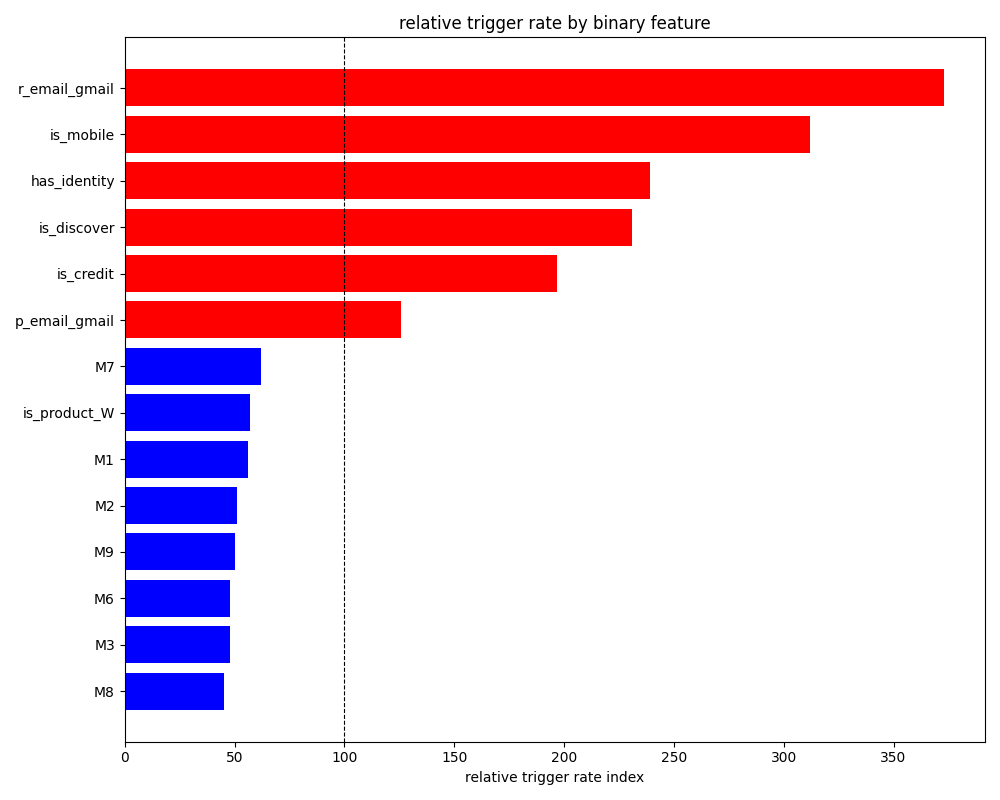

# Fraud Modeling Pipeline

End-to-end fraud detection pipeline built on the [IEEE-CIS Fraud Detection](https://www.kaggle.com/c/ieee-fraud-detection/data) dataset. Covers the full model development lifecycle, from raw data to an operationalized decision strategy, following production ML standards.

This is intended to be a re-usable pipeline for fraud modeling. There are 14 stages, with functions extracted to src files, and demonstrated using modularized notebooks. Extensive due dilligence spent on feature engineering, selection, and transformations, including creation of graph-related features. 

**New:** Stage 14 explores context optimization for a tabular foundation model (TabICLv2). [Read the write-up](docs/tfm_optimization.md).

---

## results

| model | features | test auc | test gini | val auc (tuning split) | val gini (tuning split) |
|---|---|---|---|---|---|
| baseline decision tree | full | 0.791 | 0.581 | 0.806 | 0.612 |
| catboost | full, default | 0.907 | 0.814 | 0.923 | 0.847 |
| xgboost | full, default | 0.893 | 0.785 | 0.915 | 0.830 |
| lightgbm | full, default | 0.902 | 0.805 | 0.914 | 0.829 |
| catboost final | selected, tuned | 0.905 | 0.810 | 0.918 | 0.836 |
| xgboost final | selected, tuned | 0.899 | 0.797 | 0.923 | 0.846 |
| lightgbm final | selected, tuned | 0.900 | 0.800 | 0.916 | 0.832 |
| **ensemble weighted** | selected, tuned | **0.905** | **0.811** | 0.925 | 0.849 |

Val was used for early stopping, tuning and blend weights, so it reads higher than test. On test, the weighted ensemble (0.905) is level with CatBoost final (0.905) and just below the retrained full-feature CatBoost (0.907); its value is stability across models.

**KS statistic (test):** 65+ (exceptional) | **Score PSI train vs test:** 0.006 (stable)






---

## tabular foundation model: context optimization

Stage 14 adds a tabular foundation model (TabICLv2) on top of the existing pipeline. A TFM has frozen weights, so the only thing to optimize is the context. The context is the set of labeled rows it compares each new transaction against. Contexts are drawn from the validation split, each row carries the top 25 SHAP features plus the production ensemble score, and every run is scored on the test split. The comparison covers a random context, a class-balanced context, a CatBoost model retrained on the same rows, and three routed 'context banks' (tree leaves, filled tree leaves, has_identity segments).

| run | description | test pr-auc | test roc-auc | sec per 100k rows |
|---|---|---|---|---|
| A | production ensemble | 0.519 | 0.905 | n/a |
| S | catboost retrained on val, same inputs | 0.558 | 0.919 | 3.6 |
| C | tfm, one class-balanced 10k context | 0.627 | 0.932 | 96.5 |
| D_seg | tfm, one context per has_identity segment | 0.626 | 0.935 | 79.4 |

A balanced context lifts pr-auc by 0.11 over production, about two thirds of which is not explained by fresher labels (untuned S). Routing on tree leaves did not beat one balanced context at this data scale; routing on has_identity ties it at about 18% lower cost. At the decline tier's volume (8,625 test transactions, score > 900), run C's precision is 0.271 vs 0.244 for the ensemble, 231 more frauds caught with the same number of declines. Timings are batch throughput on a 4 gb laptop gpu.



Stage 14 is an experimental extension; the production scoring path remains stages 1-13. If adopted, the TFM would sit behind the ensemble as a second-stage scorer for the step-up band, with its own PSI monitoring and reason codes.

Full write-up: [docs/tfm_optimization.md](docs/tfm_optimization.md)

---

## pipeline

| stage | notebook | description |
|---|---|---|
| 01 | 01_data_creation | load, merge, clean, null analysis |
| 02 | 02_eda | time series, categoricals, trigger rate analysis |
| 03 | 03_feature_engineering | graph features, velocity features, transforms |
| 04 | 04_train_test_split | chronological 70/15/15 split |
| 05 | 05_baseline | decision tree baseline |
| 06 | 06_model_training | catboost, xgboost, lightgbm: full feature set |
| 07 | 07_feature_selection | variance, correlation, MI, chi2, catboost, shap |
| 08 | 08_tuning | optuna bayesian optimization, 50 trials each |
| 09 | 09_final_training | tuned models + weighted ensemble |
| 10 | 10_evaluation | full model comparison on test set |
| 11 | 11_mrm | ks statistic, psi, uniform score transformation |
| 12 | 12_explainability | weighted ensemble shap |
| 13 | 13_fraud_rules | score-based decision strategy with shap explanations |
| 14 | 14_tfm_context | tabular foundation model (tabicl v2), context optimization |

---

## key features

### graph-based network features
transactions are represented as a graph where nodes are entities
(cards, email domains, addresses, devices) and edges are shared
transactions. four graph metrics computed per entity:

- pagerank (structural influence in the network)
- weighted pagerank (influence scaled by transaction amount)
- degree centrality (number of unique connections)
- connected component size (fraud ring membership)


### velocity and linkage features
21 aggregation features capturing historical entity behavior:

```
card1__addr1__nunique         (unique addresses per card)
card1__R_emaildomain__nunique (unique recipient domains per card)
card1__TransactionID__count   (transaction velocity per card)
P_emaildomain__card1__nunique (unique cards per purchaser email)
```

### feature selection
multi-method selection stack reduces 457 features to 115:

1. variance threshold
2. correlation filter (>0.95 threshold)
3. mutual information
4. selectkbest + chi-squared
5. catboost importance
6. shap values

features surviving at least two ranking methods are retained.

### model risk management
- **ks statistic:** 65+ on test set, exceptional separation
- **score psi:** 0.006 train vs test, stable population
- **uniform score transformation:** raw probabilities mapped to
  0-1000 scale fitted on training distribution for operational use


### decision strategy
score-based tiers with shap-driven explanations, measured on the test split:

| tier | threshold | precision | pct transactions | pct fraud caught |
|---|---|---|---|---|
| decline | score > 900 | 24.4% | 9.7% | 68.3% |
| step-up | 500 < score ≤ 900 | 2.4% | 38.5% | 27.0% |
| approve | score ≤ 500 | 0.3% | 51.8% | 4.8% |

thresholds configurable in `config.py`. shap identifies the
primary fraud driver per transaction for the analyst queue.



---

## top fraud signals (shap)

| feature | description |
|---|---|
| C13 | number of linked accounts on card |
| C1 | number of addresses associated with card |
| D15, D1 | timedelta features: account age and recency |
| TransactionAmt | transaction amount |
| card1__R_emaildomain__nunique | unique recipient domains per card |
| card1__TransactionAmt__mean | average transaction amount per card |



---

## eda highlights

- **76.2%** of transactions have no identity data, structural,
  not random. fraud rate with identity: **7.96%** vs without: **2.10%**
- recipient gmail address appears **4x** more often in fraud (trigger rate ix=375)
- mobile transactions **3x** more likely to be fraud (ix=315)
- discover card **2x** baseline fraud rate (ix=230)
- m-columns (verification matches) consistently protective, all negative trigger rates


---

## repo structure

```
fraud_model/
├── README.md
├── STATUS.md              ← full project status and results
├── SETUP.md               ← environment setup instructions
├── config.py              ← paths, constants, thresholds
├── requirements.txt
├── mod_funcs.py           ← original utility functions
├── assets/                ← key plots
├── data/                  ← gitignored, see data setup below
├── docs/
│   ├── project_decisions.md
│   ├── stage_specs.md
│   ├── stage7_feature_selection_plan.md
│   └── tfm_optimization.md       ← stage 14 write-up
├── src/
│   ├── utils.py           ← full_value_counts, get_relative_trigger
│   ├── features.py        ← data loading, cleaning, engineering
│   ├── graph.py           ← entity graph construction, graph features
│   ├── model.py           ← train functions for all models
│   ├── selection.py       ← feature selection methods
│   ├── tuning.py          ← optuna objective functions
│   ├── evaluation.py      ← metrics, plots, comparison functions
│   ├── mrm.py             ← ks, psi, score transformation
│   ├── explainability.py  ← ensemble shap functions
│   ├── experiment.py      ← experiment logger
│   ├── rules.py           ← decision strategy functions
│   └── tfm.py             ← tabular foundation model contexts and scoring
├── notebooks/             ← 14 notebooks, run in order (incl. 14_tfm_context.ipynb)
├── tests/
│   └── test_tfm.py        ← offline tests for src/tfm.py
└── outputs/               ← gitignored, regenerated by running notebooks
    ├── models/
    ├── plots/
    └── results/
```

---

## setup

### 1. clone the repo

```bash
git clone https://github.com/TimFlocke/fraud_model.git
cd fraud_model
```

### 2. create virtual environment

```bash
python -m venv fraud_env
fraud_env\Scripts\activate      # windows
source fraud_env/bin/activate   # mac/linux
```

### 3. install dependencies

```bash
pip install -r requirements.txt
```

### 4. download data

- go to https://www.kaggle.com/c/ieee-fraud-detection/data
- accept competition rules
- download `train_transaction.csv` and `train_identity.csv`
- place both files in `data/`

### 5. run notebooks in order

```
01 → 02 → 03 → 04 → 05 → 06 → 07 → 08 → 09 → 10 → 11 → 12 → 13 → 14
```

each notebook loads outputs from the previous stage.
models load from disk if already trained, no unnecessary retraining.

---

## gpu support

gpu detected automatically via `get_device()` in `config.py`.
catboost, xgboost, and lightgbm all use gpu if nvidia gpu is available,
falling back to cpu on any machine. no configuration required.

---

## experiment tracking

all training runs logged to `outputs/results/experiment_log.json`.
view full progression from baseline to final ensemble:

```python
from src.experiment import load_experiment_log
log = load_experiment_log('outputs/results')
print(log[['model', 'val_auc', 'val_gini']].sort_values('val_auc', ascending=False))
```

---

## configurable thresholds

all key parameters in `config.py`:

```python
NULL_THRESHOLD = 0.80              # null drop threshold
RANDOM_STATE = 42
TARGET = 'isFraud'
RULES_TOP_N_FEATURES = 10          # shap features for decision strategy
STRATEGY_APPROVE_THRESHOLD = 500   # score at or below this = approve
STRATEGY_DECLINE_THRESHOLD = 900   # score above this = decline
```

---

## future experiments

- **rule-based model routing**: segment transactions using hard
  business rules (has_identity, device type, card network) and route
  each segment to the model with highest segment-level auc. has_identity
  routing tested in stage 14 (D_seg) ties a single balanced tfm context
  at about 18% lower scoring cost
- **tabular transformer**: TabNet or FT-Transformer comparison
  against gradient boosting (stage 14 covers a tabular foundation
  model, TabICLv2)
- **reusable pipeline agent**: generalize to any labeled transaction
  dataset via cli: `python run_pipeline.py --data dataset.csv --target fraud_label`
- **PaySim validation**: run pipeline on secondary dataset to
  confirm generalization

---

## dependencies

key libraries: `catboost` `xgboost` `lightgbm` `shap` `optuna`
`networkx` `scikit-learn` `pandas` `numpy` `matplotlib` `seaborn`

see `requirements.txt` for full list with pinned versions.
