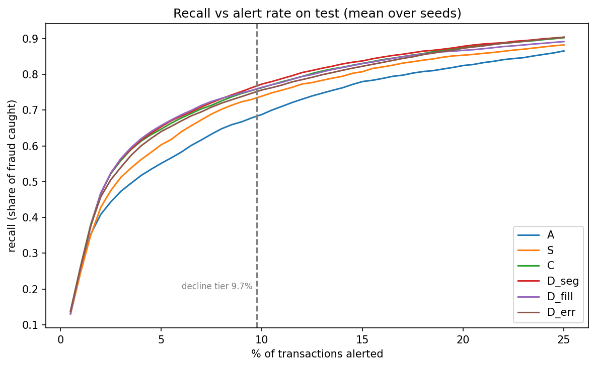
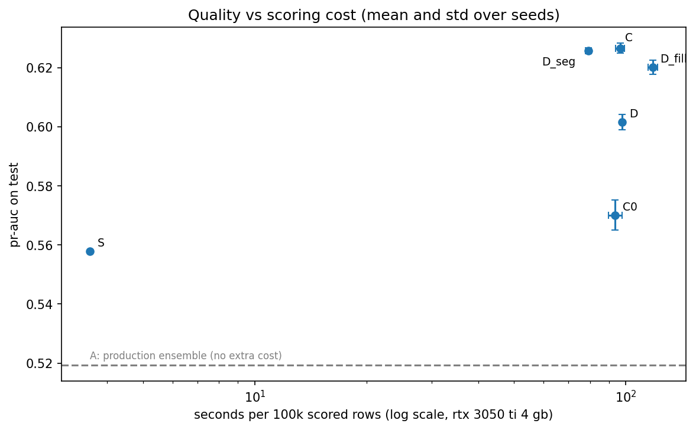
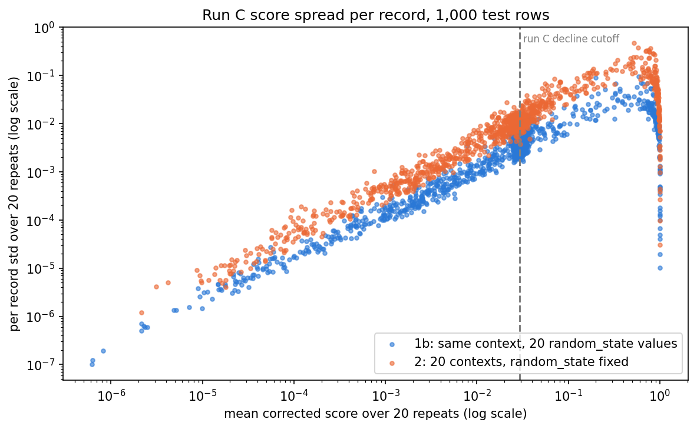

# TFM Optimization Process

*Author: Timothy Flocke*

**Contents**

1. [Summary](#summary)
2. [Methodology](#methodology)
3. [Results](#results)
4. [Future Iterations](#future-iterations)
5. [How was this built?](#how-was-this-built)

---

## Summary

The existing fraud model repo was augmented to explore the usage and optimization of a tabular foundation model. Given such a tabular foundation model, various ways to optimize were explored and documented in the stage 14 notebook. 

### What is a tabular foundation model?

In contrast to a classically used gradient boosted tree model, which is first trained on a training set, fine tuned using a validation set, and then tested on a test set, a TFM is not exposed to any training data. It is a large pretrained transformer model that is shown 'context' at inference time. This context consists of a subset of records with labeled outcomes (i.e. fraud vs non fraud), which are encoded by the pretrained transformer. The model then compares each new record against these labeled examples and returns a fraud probability in a single pass, with no training step.

### Which TFM was chosen for this demo and why?

I used TabICLv2 for three reasons:

1. The license is permissive and ideal for a public repo.
2. Practical 'scikit-learn' style fit / predict_proba interface, which works with the existing pipeline. 
3. TabICLv2 benchmarks among the top tabular foundation models. 

### What are the goals of this analysis?

There are two key factors when optimizing context for a TFM: 1) Selecting the best rows to show the model, and 2) Optimizing the selection and inferencing pipeline such that latency is minimized. A boosted tree model is considered low latency because all of the work is done at training with the weights being saved for quick usage at inference time. Conversely, all the heavy lifting for a TFM is done AT inference time, requiring careful consideration to reduce overhead computational cost. 

---

## Methodology

### How was the data set up?

The existing IEEE-CIS feature set and chronological 70/15/15 split were reused, and nothing was retrained. The validation set was used as the 'context pool'... every context the TFM sees is drawn from this tranche. The production models never trained on validation data, so their scores there are out-of-sample. That said, the validation set was used for early stopping and to set the ensemble blend weights, so the ensemble looks a bit better on validation (0.925 AUC) than on test (0.905). The TFM learns from these slightly optimistic scores, which is one reason I added run S as a check (see below). Furthermore, the validation set was the time period right before the test set. All runs were evaluated on the test set, the same as the stage 10 evaluation notebook.

### What does the TFM see?

In concept, it seemed wise to narrow the features using importance. Hence, each context row has the top 25 features by ensemble SHAP importance, plus the production ensemble score ('prior_score'). As I was building on an existing project, including the score lets the TFM build on the existing model and focus on where it is wrong, so it doesn't have to learn fraud from scratch. 

### Was any additional feature engineering needed?

Please note that missing-value flags for 9 of the features were created. TabICLv2 fills missing values with the average, which throws away a strong fraud signal (for example: fraud is 12.7% when addr1__card1__nunique is missing vs 2.4% when it isn't). The TFM sees 35 features once completed.

### Which approaches were compared?

Increasingly more complex context builds were constructed ranging from a simple 10k record context used for all records to more dynamic context banking and routing, where pre-selected contexts were used after deciding on the most similar. 

Each run changes one thing, so the effect of each choice can be isolated:

| Run | Description |
|---|---|
| **A** | The production ensemble score on its own. This is the bar to beat. |
| **C0** | The TFM with one random 10,000 row context (about 3.4% fraud). |
| **C** | The TFM with one class-balanced 10,000 row context, set to 20% fraud. With a random sample, the model only sees around 340 frauds; balancing gives it far more fraud patterns to compare against. |
| **S** | A CatBoost model trained on the validation set with the same 35 inputs. This checks whether any lift comes from the TFM itself, or just from seeing newer labeled data than the ensemble did. |
| **D** | A 'context bank'. A shallow decision tree on the top 5 features splits the context pool into regions, and each region gets its own context, built ahead of time. At inference, each transaction is routed to its region with a simple lookup and scored against that region's context. |
| **D_seg** | The same bank, but routed on a simple business segment (has_identity) instead of the tree. |
| **D_fill** | The same as D, but each region's context is filled with its own non-fraud rows up to 10,000 rows, or the whole region if smaller, so most transactions see a context about the same size as in run C. |
| **D_err** | The same bank, but split at the decision strategy's decline threshold, so one context holds the transactions the ensemble flags (true and false positives) and the other holds the ones it passes (true and false negatives). |

### How were the runs measured?

Every TFM run was repeated with 3 random seeds, each drawing a different sample of context rows, and reported as the mean and spread. A single pull would not be as informative. Quality was measured with PR-AUC, ROC-AUC, and recall at a 1% and 20% alert rate. The 20% rate is a fixed comparison rate. The stage 13 decline tier currently flags 9.7% of test transactions. Cost was measured as seconds to score 100,000 transactions, since that is where a TFM spends its compute.

---

## Results

### What were the results?

The table below shows every run on the test set. For the TFM runs, each number is the mean across the 3 seeds, with the spread after the ± sign. Cost is seconds to score 100,000 transactions.

| Run | PR-AUC | ROC-AUC | Recall at 1% | Recall at 20% | Seconds per 100k |
|---|--:|--:|--:|--:|--:|
| A | 0.519 | 0.905 | 0.254 | 0.825 | n/a (existing score) |
| C0 | 0.570 ± 0.005 | 0.920 ± 0.001 | 0.254 ± 0.004 | 0.852 ± 0.003 | 93.7 |
| C | **0.627 ± 0.002** | 0.932 ± 0.001 | **0.264 ± 0.003** | 0.875 ± 0.003 | 96.5 |
| S | 0.558 | 0.919 | 0.246 | 0.854 | **3.6** |
| D | 0.602 ± 0.003 | 0.926 ± 0.002 | 0.258 ± 0.001 | 0.863 ± 0.010 | 97.6 |
| D_seg | 0.626 ± 0.001 | **0.935 ± 0.000** | 0.262 ± 0.001 | **0.879 ± 0.001** | 79.4 |
| D_fill | 0.620 ± 0.002 | 0.930 ± 0.002 | 0.260 ± 0.001 | 0.867 ± 0.010 | 118.2 |
| D_err | 0.613 ± 0.003 | 0.933 ± 0.000 | 0.262 ± 0.001 | 0.873 ± 0.003 | 71.5 |

*Recall (share of test fraud caught) against the share of test transactions alerted, mean over 3 seeds, with the stage 13 decline tier marked.*

### Did the TFM beat the production ensemble and a retrained model?

Yes. With one class-balanced context (run C), PR-AUC on the test set rose from 0.519 to 0.627, and recall at a 20% alert rate went from 82.5% to 87.5% of fraud caught. The CatBoost model trained on the same validation rows and inputs (run S) reached 0.558. Every TFM run, from the random context (C0, 0.570) to the routed banks (0.602 to 0.626), beat both the ensemble and run S on PR-AUC, so the lift held up regardless of how the context was built. So roughly a third of the lift comes from seeing newer labeled data, and the rest comes from the TFM, at least against an untuned CatBoost model. The TFM got there while looking at 10,000 validation rows, where CatBoost trained on about 71,000. At the 1% alert rate the gain is small (25.4% to 26.4%); most of the improvement shows up deeper in the ranking. At the decline tier's volume (8,625 test transactions, score > 900), run C's precision is 0.271 vs 0.244 for the ensemble, 2,335 vs 2,104 frauds on average across seeds, so 231 more frauds caught with the same number of declines.

### How much did balancing the context matter?

A lot. The random context (run C0) holds only about 340 frauds and reached 0.570. The balanced context of the same size holds 2,000 frauds and reached 0.627. Since the context is the only thing that can be changed, choosing which rows go into it was the biggest lever I found.

### Did routing help?

Not at this data scale. The tree bank (run D) scored 0.602, below the single context. Keeping each region at 20% fraud meant regions with little fraud got very small contexts, as small as 280 rows. Filling each region with its own non-fraud rows, up to 10,000 rows or the whole region if it was smaller (run D_fill), recovered most of the gap (0.620) and beat the single context in 4 of the 7 regions. However, the low-fraud regions only had 56 to 201 frauds to show the model, and adding non-fraud rows does not fix that. Routing on has_identity (run D_seg) makes two large segments, each with plenty of fraud, and it tied the single context (0.626). With about 3,000 frauds in the pool, one big balanced context was the better choice. Routing may pay off with a larger pool, where every region has enough fraud of its own.

| Region | Rule | Test rows | Test fraud | D context rows | D_fill context rows (fraud) | C | D | D_fill |
|--:|---|--:|--:|--:|--:|--:|--:|--:|
| 3 | C5 <= 0.5, C1 <= 3.5, D15 <= 101.5 or missing | 33,855 | 4.3% | 7,725 | 10,000 (15.5%) | 0.394 | 0.410 | 0.414 |
| 4 | C5 <= 0.5, C1 <= 3.5, D15 > 101.5 | 14,410 | 1.9% | 1,005 | 10,000 (2.0%) | 0.719 | 0.644 | 0.692 |
| 5 | C5 <= 0.5, C1 > 3.5 | 6,671 | 15.6% | 4,465 | 5,058 (17.7%) | 0.882 | 0.853 | 0.853 |
| 8 | C5 > 0.5, TransactionAmt <= 108.8, D15 <= 96.5 or missing | 9,727 | 1.1% | 670 | 10,000 (1.3%) | 0.284 | 0.241 | 0.367 |
| 9 | C5 > 0.5, TransactionAmt <= 108.8, D15 > 96.5 | 14,214 | 0.5% | 395 | 10,000 (0.8%) | 0.585 | 0.458 | 0.563 |
| 11 | C5 > 0.5, TransactionAmt > 108.8, D15 <= 101.5 or missing | 5,037 | 1.7% | 670 | 5,596 (2.4%) | 0.310 | 0.313 | 0.343 |
| 12 | C5 > 0.5, TransactionAmt > 108.8, D15 > 101.5 | 4,667 | 1.1% | 280 | 5,020 (1.1%) | 0.845 | 0.797 | 0.896 |

The last three columns are PR-AUC on each region's test rows only.

### Did focusing contexts on the model's errors help?

Not really. Splitting at the decline threshold (run D_err) scored 0.613, below the single context. The flagged segment holds most of the fraud (2,228 of the 3,042 frauds in the pool) and got a 7,626 row context, and there the TFM did about as well as run C (0.773 vs 0.773 PR-AUC within the segment). The passed segment is where the missed frauds are, but it held only 814 of them, so its context shrank to 4,070 rows and it did worse than run C at finding them (0.218 vs 0.262). It is the same problem as the tree regions. A context can only teach the model about errors it has enough examples of.

### What did it cost?

Run C took about 97 seconds to score 100,000 transactions on my laptop GPU. D_seg matched its quality at about 79 seconds, roughly 18% cheaper, because its two contexts are a bit smaller. D_fill was the most expensive at about 118 seconds, since it fits seven separate contexts. CatBoost (run S) scored the same 100,000 transactions in about 3.6 seconds, around 27 times cheaper than run C. That is the trade-off with a TFM. There is no training step, but the context is part of every scoring call.

*Test PR-AUC against seconds to score 100,000 transactions (log scale), mean and spread over seeds, with the production ensemble as the reference line.*

### How stable are the predictions?

I took 1,000 test transactions (312 frauds, the 300 transactions ranked closest to run C's decline cutoff, and random non-fraud for the rest) and scored them 20 times in three setups. The cutoff declines the same share of test as the stage 13 decline tier (9.7%). With the same context and the same TabICL seed (test 1a), all 20 runs gave identical scores. With the same context and 20 different TabICL seeds (test 1b), scores moved a little, and the rank correlation between any two runs was at least 0.960. With 20 different balanced contexts (test 2), the median spread was 4.4 times larger for frauds and 3.2 times larger for non-fraud, and the rank correlation dropped to 0.916 at its lowest. Most of the movement is in high-scoring transactions. Most decision flips are at the cutoff: 285 of the 300 transactions nearest it changed decision at least once in test 1b and 282 in test 2, against 29 and 117 of the other 700. So which rows go into the context matters more than TabICL's own randomness, and averaging scores over a few contexts could steady decisions near the cutoff. Scoring the same 1,000 transactions inside the full test set also gave slightly different scores (21 of the 1,000 decisions differ), so the way rows are batched on the GPU adds a little noise too.

| Test | Setup | Std, fraud | Std, non-fraud | Std, near cutoff | Std, other | Rank correlation, mean (min) | Flip rate |
|---|---|--:|--:|--:|--:|--:|--:|
| 1a | Same context, same TabICL seed | 0 / 0 | 0 / 0 | 0 / 0 | 0 / 0 | 1.000 (1.000) | 0.0% |
| 1b | Same context, 20 TabICL seeds | 0.0066 / 0.0429 | 0.0015 / 0.0082 | 0.0035 / 0.0089 | 0.0008 / 0.0286 | 0.976 (0.960) | 31.4% |
| 2 | 20 contexts, same TabICL seed | 0.0287 / 0.2182 | 0.0047 / 0.0310 | 0.0109 / 0.0394 | 0.0027 / 0.1307 | 0.933 (0.916) | 39.9% |

Std cells show the median / 95th percentile of each transaction's standard deviation across the 20 runs, on the corrected score. The flip rate is the share of the 1,000 transactions whose decline decision changed in at least one run.

Across the full test set the flip rate is much lower. Between any two of run C's three seeds, 3.4% of all test transactions change decline decision (6.4% of frauds and 3.3% of non-fraud), and the rank correlation between seeds is 0.939 on average. The sample's flip rate is high because 300 of its 1,000 transactions were picked right at the cutoff, where a small change in score changes the decision.

*Each transaction's standard deviation across 20 runs against its mean score (both log scale), for 20 TabICL seeds on one context (1b) and 20 different contexts (2), with run C's decline cutoff marked.*

The table below follows 10 test transactions (5 frauds, 5 non-fraud) through 10 runs, each with a new balanced context and the TabICL seed set to the run number. Clear cases barely move and borderline ones swing more (fraud 28577 ranges from 0.410 to 0.752), and in every run all 5 frauds scored above all 5 non-fraud.

| Record id | Label (1 = fraud) | prior_score | Seed 0 | Seed 1 | Seed 2 | Seed 3 | Seed 4 | Seed 5 | Seed 6 | Seed 7 | Seed 8 | Seed 9 | Mean | Min | Max | Std |
|--:|--:|--:|--:|--:|--:|--:|--:|--:|--:|--:|--:|--:|--:|--:|--:|--:|
| 28577 | 1 | 0.578 | 0.657 | 0.749 | 0.700 | 0.538 | 0.607 | 0.746 | 0.631 | 0.410 | 0.613 | 0.752 | 0.640 | 0.410 | 0.752 | 0.102 |
| 31726 | 1 | 0.173 | 0.105 | 0.132 | 0.087 | 0.040 | 0.118 | 0.084 | 0.052 | 0.066 | 0.083 | 0.146 | 0.091 | 0.040 | 0.146 | 0.032 |
| 50113 | 1 | 0.957 | 0.992 | 0.991 | 0.983 | 0.997 | 0.995 | 0.989 | 0.986 | 0.994 | 0.993 | 0.995 | 0.992 | 0.983 | 0.997 | 0.004 |
| 61446 | 1 | 0.858 | 0.969 | 0.989 | 0.987 | 0.965 | 0.991 | 0.986 | 0.993 | 0.988 | 0.986 | 0.991 | 0.984 | 0.965 | 0.993 | 0.009 |
| 76777 | 1 | 0.992 | 0.976 | 0.992 | 0.986 | 0.986 | 0.988 | 0.993 | 0.984 | 0.986 | 0.995 | 0.992 | 0.988 | 0.976 | 0.995 | 0.005 |
| 44412 | 0 | 0.109 | 0.032 | 0.043 | 0.025 | 0.025 | 0.033 | 0.028 | 0.033 | 0.034 | 0.025 | 0.029 | 0.031 | 0.025 | 0.043 | 0.005 |
| 53591 | 0 | 0.031 | 0.012 | 0.013 | 0.010 | 0.010 | 0.011 | 0.014 | 0.016 | 0.015 | 0.016 | 0.008 | 0.013 | 0.008 | 0.016 | 0.003 |
| 57400 | 0 | 0.009 | 0.003 | 0.001 | 0.003 | 0.002 | 0.006 | 0.002 | 0.001 | 0.003 | 0.012 | 0.004 | 0.004 | 0.001 | 0.012 | 0.003 |
| 71935 | 0 | 0.019 | 0.008 | 0.010 | 0.008 | 0.009 | 0.008 | 0.013 | 0.010 | 0.011 | 0.006 | 0.011 | 0.009 | 0.006 | 0.013 | 0.002 |
| 80792 | 0 | 0.002 | 0.000 | 0.001 | 0.000 | 0.000 | 0.001 | 0.001 | 0.000 | 0.000 | 0.000 | 0.000 | 0.000 | 0.000 | 0.001 | 0.000 |

Raw scores are from a 20% fraud context and are higher than real-world probabilities; ranking is unaffected.

### What are the caveats?

1. The validation scores the TFM learns from are mildly optimistic, because the validation set was used for early stopping and to set the ensemble blend weights. A stricter setup would build the context pool from a held-out slice of training data instead.
2. Run S is an untuned CatBoost model. Tuning it would likely narrow the gap to the TFM.
3. The timings are batch throughput on a 4 GB laptop GPU. Production latency for a single transaction was not measured.

---

## Future Iterations

### What would I try next?

A few ideas came up while working through this that I did not have time to test:

1. A library of pre-encoded contexts. Each segment's context could be encoded once, saved, and pulled from a library at scoring time, then refreshed on a schedule as new labels mature. This removes the cost of encoding the context, although the model still has to compare each new record against it, so smaller contexts would still matter. Pairing this with the has_identity bank (run D_seg), which already matched the single context at lower cost, seems like the natural place to start.
2. Pushing the context further toward fraud. Balancing the context from 3.4% to 20% fraud was the biggest gain I found (run C0 to run C). A context at 50% fraud or more, with a smaller sample of non-fraud rows as background, would show whether that gain keeps going or levels off.
3. Retrieving the most similar records within a segment. Each batch of transactions could pull its nearest labeled neighbors from within its segment, using the top SHAP features to measure similarity, with a bias toward more recent records. This should give the most relevant context, but it costs more, since contexts can no longer be reused across batches. This is the most computationally expensive of the three. 

---

## How was this built?

I used Claude as a planning partner to design the experiments and review results, and Claude Code to implement them in the repo, with a review step before anything was committed. The core ideas including model research were my own: putting the production ensemble score into the context, the context bank with a lookup to pre-built contexts, and splitting contexts on the model's errors (D_err). I also chose the decision tree as the bank's routing method, and the review steps caught issues like the stale decision thresholds before submission.
